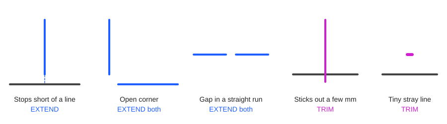

# Line Gap Checker

**An AutoCAD plugin that finds the small drawing mistakes your eye misses: lines that stop a few centimetres short, and lines that stick out a few millimetres too far. It colours them so you can fix them.**



## What it does

When you draw in AutoCAD, lines often *look* connected but aren't. You only notice when hatching fails, an area won't close, or a CNC/GIS export breaks. Line Gap Checker scans your **lines, arcs, circles and polylines** and colours every problem:

| Colour | Meaning | Caught when |
|---|---|---|
| 🔵 **Blue** | **Extend this object** | Its end stops short of another object, an open corner, or a gap in a straight run or round an arc. Gaps up to **10 cm** are reported. |
| 🟣 **Magenta** | **Trim this object** | It sticks out past a crossing by **5 mm or less**, or the whole object is **5 mm or shorter** (stray bits, zero-length lines). |

Objects that connect properly at corners, T-junctions and crossings are left alone. Your original colours are saved, so one command puts everything back.

## Install

**You need:** full AutoCAD 2019 or newer on 64-bit Windows. AutoCAD LT can't run plugins. You don't need admin rights or any build tools.

Pick one of the two ways below. All downloads are on the [latest release page](https://github.com/lumidren/Line-Gap-Checker/releases/latest).

### Way 1: install once, loads on every start (recommended)

1. **Close AutoCAD.**
2. Install it with **either** of these:
   - **PowerShell, one line.** Start menu → type `powershell` → Enter. Paste this line and press Enter:
     ```powershell
     irm https://raw.githubusercontent.com/lumidren/Line-Gap-Checker/main/install.ps1 | iex
     ```
   - **Zip.** Download **`LineGapChecker.zip`**, right-click it → **Extract All**, then double-click **`install.bat`** in the extracted folder.
3. **Start AutoCAD.** If it asks whether to load `LineGapChecker.dll`, choose **Always Load**.
4. The command line shows `LineGapChecker loaded. Commands: GAPCHECK, GAPSET, GAPRESET`. You're ready.

You don't need to pick a version: the install holds the builds for AutoCAD 2019–2024, 2025–2026 and 2027+, and AutoCAD loads the right one.

### Way 2: load a single DLL for this session only

Good for a quick try, or on a PC where you don't want to install anything.

1. Download the DLL for your AutoCAD. To find your version, type `ABOUT` in AutoCAD, or look at the year on the start-up screen.

   | Your AutoCAD | Download |
   |---|---|
   | 2019, 2020, 2021, 2022, 2023, 2024 | `LineGapChecker-AutoCAD-2019-2024.dll` |
   | 2025, 2026 | `LineGapChecker-AutoCAD-2025-2026.dll` |
   | 2027 and newer | `LineGapChecker-AutoCAD-2027.dll` |

2. Right-click the downloaded file → **Properties** → tick **Unblock** at the bottom → **OK**. Windows blocks downloaded DLLs, and AutoCAD won't load a blocked one.
3. In AutoCAD, type `NETLOAD`, press Enter and pick the file. If AutoCAD asks, choose **Load Once** or **Always Load**.

The plugin stays loaded until you close AutoCAD. After a restart, run `NETLOAD` again, or use Way 1.

### Update or remove

- **Update:** close AutoCAD and repeat Way 1 with the new release. It replaces the old version.
- **Remove:** run `GAPRESET` in any drawing that still has coloured objects, close AutoCAD, then double-click `uninstall.bat` from the zip, or run:
  ```powershell
  & ([scriptblock]::Create((irm https://raw.githubusercontent.com/lumidren/Line-Gap-Checker/main/install.ps1))) -Uninstall
  ```

📘 For security prompts, trusted folders and troubleshooting, see **[INSTALL.md](INSTALL.md)**.

## How to use it

### Commands

| Command | What it does |
|---|---|
| `GAPCHECK` | Checks the drawing and colours problems: **blue** = extend, **magenta** = trim |
| `GAPSET` | Changes the limits (gap size, overshoot size, units) for this AutoCAD session |
| `GAPRESET` | Gives every coloured object its original colour back |

### Step by step

1. **Check the drawing units once.** Type `UNITS` and look at **Insertion scale**. It must say what one drawing unit really is (Millimeters, Meters, and so on). The limits are in real metres, so the plugin converts them using this setting. Wrong units give wrong results.
2. **Run the check.** Type `GAPCHECK` and press Enter. Then either:
   - press **Enter** again to check everything in the current model space or layout, or
   - select only the objects you want (a window works), then press Enter.

   You can also select objects first and then type `GAPCHECK`.
3. **Read the result.** Problem objects turn blue or magenta. The command line shows a summary like this:
   ```
   GAPCHECK: 1240 object(s) checked in 85 ms. Units: millimetres (INSUNITS=4).
     1100 line(s), 60 arc(s), 10 circle(s), 70 polyline(s).
     To extend (blue):   3
     To trim (magenta):  2
     Findings:
       TRIM overshoot      0.0040 m  at 6000,-4
       EXTEND to line      0.0500 m  at 2000,50
   ```
   Each finding line gives the problem, its size in metres, and the point in drawing coordinates where it is. Up to 30 findings are listed. Press **F2** to open the text window if the list scrolls away.

   | Finding | Meaning | Fix with |
   |---|---|---|
   | `EXTEND to line` | The end stops short of another object | `EXTEND` |
   | `EXTEND corner` | Two ends both stop short of the corner they should meet at | `FILLET` with radius 0, or `EXTEND` both |
   | `EXTEND collinear` | A gap in a straight run, or between arcs on the same circle | `JOIN`, or `EXTEND` |
   | `TRIM overshoot` | The end sticks out past a crossing by a few mm | `TRIM` |
   | `TRIM short line` | The whole object is tiny (5 mm or less), usually a stray bit | `ERASE` |

4. **Find and fix them.**
   - To jump to a finding, type `ZOOM` → `C` (Center), type the point from the summary, e.g. `2000,50`, then a small height.
   - To select every flagged object at once, use `QSELECT` → **Color** → **Blue** (or **Magenta**).
   - Fix them with `EXTEND`, `TRIM`, `FILLET` (radius 0) or `ERASE`.
5. **Check again.** Run `GAPCHECK` until it reports `0` to extend and `0` to trim. Each run restores the previous colours first, so results never pile up.
6. **Clean up.** Type `GAPRESET` to put every original colour back, then save.

Changed your mind? One `UNDO` right after `GAPCHECK` reverses the whole check.

### Changing the limits (optional)

Type `GAPSET`, pick an option, type the new value, and press **Enter** on an empty prompt to finish. Lengths are in metres. The values last until AutoCAD is closed, then the defaults apply again.

| Option | Default | What it controls |
|---|---|---|
| `Short` | 0.005 m (5 mm) | Largest overshoot to trim. Objects this short or shorter are flagged too. |
| `Gap` | 0.10 m (10 cm) | Largest gap to report. Bigger gaps are treated as intentional. |
| `Tolerance` | 0.000001 m | How close two objects must be to count as touching |
| `Units` | 0 = automatic | Drawing units per metre. Leave it at 0 to read `INSUNITS`. Set it, for example `1000` for millimetres, only if the drawing's units are wrong and you can't change them. |
| `Defaults` | | Puts everything back to the defaults |

The plugin understands mm, cm, m, km, inches, feet, yards, miles and more. If the drawing has no units set, it assumes metres and prints a warning.

### Good to know

- **Locked layers** are checked but not recoloured. The summary says how many were skipped: unlock the layer and run `GAPCHECK` again.
- **A whole polyline turns blue or magenta** even when only one end is wrong, because a polyline is one object. The summary's point shows which end.
- **Colours are saved in the drawing.** If you save and close before `GAPRESET`, run `GAPRESET` later. It still restores the original colours.

### What gets checked

| Checked | Not checked (counted as skipped) |
|---|---|
| `LINE`, `ARC`, `CIRCLE`, polylines (`LWPOLYLINE`, including arc segments) and simple 2D/3D `POLYLINE`s | Spline- or curve-fit polylines, meshes, and arcs, circles or polylines that are not drawn flat in the XY plane. Ellipses and splines are not selected at all. |

- **Arcs extend along their circle**, just like AutoCAD's `EXTEND`, and their gaps and overshoots are measured along the curve.
- **A polyline is one object.** Only its two ends can be free: its corners never count as gaps. If it needs fixing, the whole polyline is coloured, and the summary gives the exact spot. A polyline can also stop short of, or run past, *itself*, for example a room outline whose last segment doesn't quite reach its first.
- **Circles and closed polylines** have no ends, so they are never coloured. Other objects can still be extended to them.

## Build from source

You only need this to change the code. The release zip is built by CI from these same steps.

| Route | Command | Needs |
|---|---|---|
| All three builds | `dotnet build LineGapChecker.csproj -c Release` | [.NET 10 SDK](https://dotnet.microsoft.com/download/dotnet/10.0). No AutoCAD: the API comes from Autodesk's official [`AutoCAD.NET`](https://www.nuget.org/packages/AutoCAD.NET) NuGet packages (2019, 2025 and 2027 versions). |
| AutoCAD 2019 – 2024 only | `build.bat "C:\Program Files\Autodesk\AutoCAD 2024"` | Only the `csc.exe` that ships with Windows, plus a local AutoCAD for its DLLs |
| Engine tests | `test.bat` | Only `csc.exe` |

Both build routes run against the AutoCAD API assemblies without copying them: AutoCAD supplies its own at run time. `build.bat` runs the unit tests first and builds the plugin only if they pass. After building, `install.bat` installs whatever is in `bin\`.

---

## How it works (technical)

### Project layout

| File | Role |
|---|---|
| `src/GapEngine.cs` | Pure geometry engine. **No AutoCAD dependency**, so it can be unit-tested anywhere. |
| `src/GapCommands.cs` | AutoCAD layer: `GAPCHECK`, `GAPSET`, `GAPRESET`, and `IExtensionApplication` |
| `tests/GapEngineTests.cs` | Unit tests (a self-contained console runner, no NuGet) |
| `LineGapChecker.csproj` | Builds `net48`, `net8.0-windows` and `net10.0-windows` against Autodesk's NuGet API packages |
| `test.bat` / `build.bat` | Engine tests, and an SDK-free `net48` build with Windows' own `csc.exe` |
| `install.ps1` / `install.bat` / `uninstall.bat` / `bundle/` | Auto-load bundle and its installers: AutoCAD loads the plugin on every start |
| `.github/workflows/build.yml` | CI: tests, all three builds, release zip, installer checks, and a GitHub release on each `v*` tag |

The sources are written in **C# 5**, so the same files compile with the old Framework `csc.exe` and with the .NET 8 and .NET 10 SDKs.

### Detection rules

All geometry is 2D, and thresholds are converted from metres to drawing units. Every object becomes a chain of straight and circular **pieces**: a line is one straight piece, an arc or circle is one circular piece, and each polyline segment is a straight piece or, when it has a bulge, a circular one.

- A **free end** is one of the two ends of an open object that is not within the touch tolerance of any other piece. That includes the object's own pieces further along, so a polyline that closes back on itself has no free ends. Interior polyline vertices are never ends.
- **Extend.** A free end grows along its **path**: a straight end along its direction, an arc end along its own circle (never past the arc's other end). It qualifies when, within the max gap:
  - **To line**: the path hits another piece.
  - **Corner**: the path meets the *extension* (straight or round) of a piece beyond its object's own free end, so both stop short.
  - **Collinear**: a line in the same direction, or an arc on the same circle, starts after a gap. An arc that almost closes on itself also counts.

  Near-parallel lines (sin θ < 1e-4) are ignored except in the collinear case. A path that only grazes a circle, within the touch tolerance, counts as one tangent hit. The nearest hit wins.
- **Trim.**
  - **Short line**: the whole object is at most the short length, including zero-length lines.
  - **Overshoot**: walking inward from a free end, along the object and across polyline vertices, a crossing appears after more than the touch tolerance and at most the short length.
- **Both**: an object needing both is coloured magenta. The summary counts these objects and tags their findings.
- **Tiny objects**: these still count as "touching" when finding free ends, but are never used as extension or crossing targets.
- **Duplicate vertices**: polyline pieces no longer than the touch tolerance are dropped before the analysis, so a repeated vertex doesn't hide the direction of the real end segment.

### Speed: a spatial grid, not O(n²)

Comparing every line with every other line takes 1.25 billion checks for 50,000 lines. Instead, the engine builds a **uniform hash grid**:

- Each straight piece is registered only in the cells it **actually passes through** (Amanatides–Woo grid traversal), not its whole bounding box. A long diagonal line costs a few cells, not thousands.
- Arcs are cut into parts of at most 45° and about one cell long. Each part is registered by its chord box, grown by the sagitta, so a big arc never fills its whole bounding square.
- The cell size is at least twice the max gap, so every query (touch test, ray, corner, overshoot) reads at most a 3×3 block of cells.
- The traversal takes exactly |Δx| + |Δy| steps, so floating-point rounding can never run past the end cell.
- Coordinates are shifted to a local origin first, so survey-sized coordinates (hundreds of km, in mm) keep full precision.

### Never losing your colours

Before recolouring an object, GAPCHECK writes its original colour into **XData** under the registered app `LINEGAPCHECK`. The record holds a format version, the colour method (ByLayer, ByBlock, ACI or true colour), the ACI index, the RGB value and, for colour-book colours, the book and colour name. `GAPRESET`, and the start of every `GAPCHECK`, rebuild the colour from that record and remove the XData.

The whole check runs in **one transaction**, so one `UNDO` reverses it. Objects are opened for read and upgraded to write only when they actually change. Objects on **locked layers** are still analysed but are not recoloured or restored, and the summary says how many were skipped.

### Reading AutoCAD geometry

Points are taken in WCS and Z is ignored, so the check works in plan view. Arcs and polylines whose normal points down (−Z, for example after `MIRROR` in 3D) run clockwise when seen from above, so their sweep and bulges are flipped. Objects whose normal is tilted are skipped rather than squashed into ellipses.

### Measured results

From `test.bat` on a laptop:

| Test | Result |
|---|---|
| 40 unit tests: T-gap, open corner, collinear gap, 4 mm overshoot (trim), 20 mm overshoot (ignored), gap > max (ignored), tiny and zero-length lines, clean corner, T and cross, mm drawing, unit table, UTM-size coordinates, and for arcs and polylines: line to arc, arc end to line along its circle, arc overshoot, gap between arcs on one circle, nearly closed arc, tangent arc, circle target, closed and self-closing polylines, polyline gap and overshoot against itself, bulge direction, overshoot across a vertex, duplicate vertices | **all pass** |
| 50,244-line lattice with injected defects | **~55 ms**, exact expected counts |
| 50,000 random lines up to 80 m long | **~420 ms**. The same results come back when the drawing is rotated 90°, which changes every grid cell. |
| 50,000 random lines, bulge arcs and polylines with arc segments | **~490 ms**. Rotated 90°, every object gets the same mark. |

### Verification status

The geometry engine is compiled and fully unit-tested. On every push, CI compiles the AutoCAD command layer (`GapCommands.cs`) against Autodesk's official API assemblies for AutoCAD 2019, 2025 and 2027. CI also installs the release zip with both installers and checks the result. The plugin **has not yet been run inside AutoCAD**, so treat the first real-drawing run as the acceptance test:

1. Draw a T with a 50 mm gap, a 4 mm overshoot, a 3 mm line, a clean corner, and a green or true-colour line. Add an arc that stops 30 mm short of a line, a polyline with an arc segment that runs 4 mm past a wall, and one arc and one polyline mirrored with `MIRROR3D` (normal −Z).
2. Run `GAPCHECK` and check the colours and the summary, including the mirrored objects.
3. Run `UNDO` and check that the drawing is back to how it was.
4. Run `GAPCHECK` again, then `GAPRESET`. Check that the original colours are back.
5. Lock a layer with a flagged line and check that the summary reports it as skipped.
6. Check an old-style 2D `POLYLINE` (convert one with `CONVERTPOLY` → Heavy) and a 3D polyline.

---

Built by **lumidren**.
